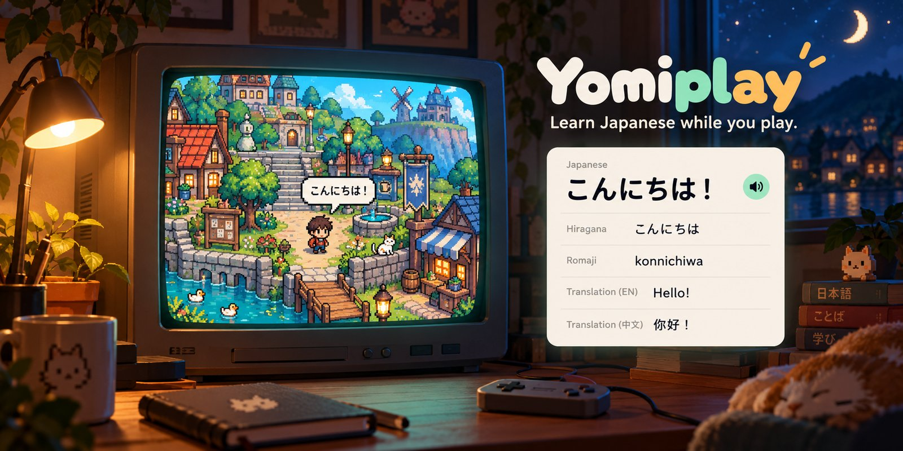
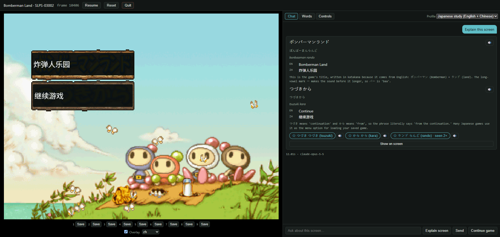
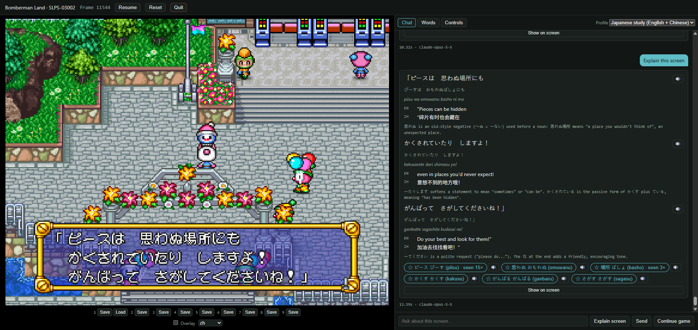

# Yomiplay



A PS1 emulator with a language model beside the game. Version 1 is a **companion for learning Japanese while you play**: ask about the screen, get study cards (transcription, reading, translations, notes), and every word you have read is counted in a personal word list. The same core is designed for LLM agents, a Gymnasium environment for RL, and benchmarks (planned).





## What you need (not included)
This project contains code only. It does not include or link to any games, BIOS files or emulator cores. Bring your own.
- A libretro PS1 core with the software renderer (Beetle PSX: `mednafen_psx_libretro.so`)
- A PS1 BIOS dump from your console (e.g. `scph5500.bin` for Japanese games)
- Your game as `.cue` + `.bin`
- Claude Code CLI, logged in (used as the model backend; no API key needed)

## Setup (WSL2/Linux)
    uv sync
    cp config.example.toml ~/.config/yomiplay/config.toml   # set core_path and bios_dir
    uv run yomiplay doctor
    uv run yomiplay serve "/path/to/game.cue"
Then open http://localhost:8765. `serve` runs until you press Quit.

Or run `uv run yomiplay app "/path/to/game.cue"`. It opens in your default browser; closing that tab stops the server after 10 seconds, with the replay saved and the memory card flushed. If no tab connects within 60 seconds, it stops too. Change both times in `[app]` of the config.

## Controls
Arrows = D-pad, X = Cross, Z = Circle, S = Triangle, A = Square, Enter = Start, Right Shift = Select, Q/W = L1/R1, 1/2 = L2/R2. Gamepads work through the browser. Rebind keys and gamepad buttons in the Controls tab (saved to `controls.json` in the config folder, which overrides `[keys.mapping]`).

The Chat tab has **Model** (Opus, Sonnet, Haiku, Fable) and **Thinking** (Off, Low … Max) pickers. The choice applies from the next question. The app saves it to `llm.json` in the config folder, which overrides `[llm]`. Thinking Off works fully on Sonnet and Haiku. Opus still thinks a little, so use Low for the fastest Opus.

## Explain
Ask about the screen to receive study cards with transcriptions, readings, translations, and notes. The translation also shows on the game screen over the original text. Turn it off or change its language with the **Overlay** controls under the screen.

The chat keeps your earlier sessions of the same game. After a restart, scroll up to read them. A divider marks where each session starts. Cards from earlier sessions are read-only. Claude does not see them: each new server session starts a new conversation.

## Explain profiles
Profiles in `profiles/` set target languages, level and style. Copy one to `~/.config/yomiplay/profiles/` and edit it; your copy overrides the default with the same `name`.

## Game profiles
Optional. Put your own measurements and hints for a disc in `~/.config/yomiplay/games/<serial>.toml`, where the serial is the disc's product code (for example `SLPS-03002`):

```toml
name = "My game"
language = "ja"
dialogue_rects = [[0.05, 0.70, 0.90, 0.25]]  # x, y, w, h as fractions of the screen
prompt_hints = "Short hints for the model, written by you."
```

Without a profile, the whole screen goes to the model.

## Known limitations
- Explain sends a screenshot to Claude. A game profile can crop it to the text box (`dialogue_rects`). Without one, Claude reads the full screen, which is slower and can pick up other text.

## Development
    ./scripts/check.sh          # lint, import rules, tests (no game files needed)
    git config core.hooksPath .githooks
See `CLAUDE.md` for the content policy.

## License
MIT. Game titles mentioned in docs are trademarks of their owners and are referenced only to describe compatibility.
